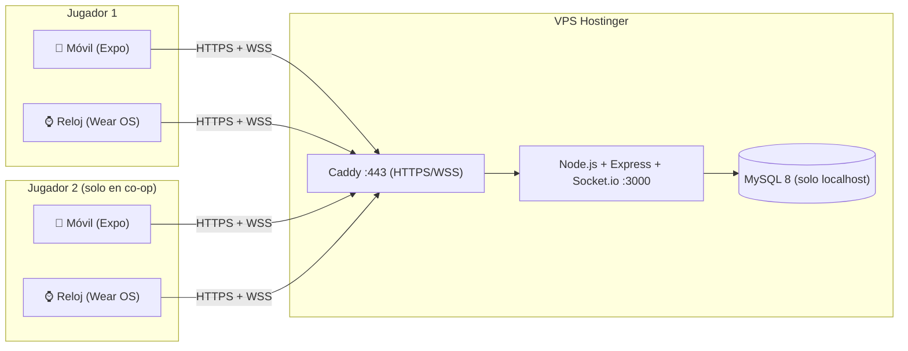
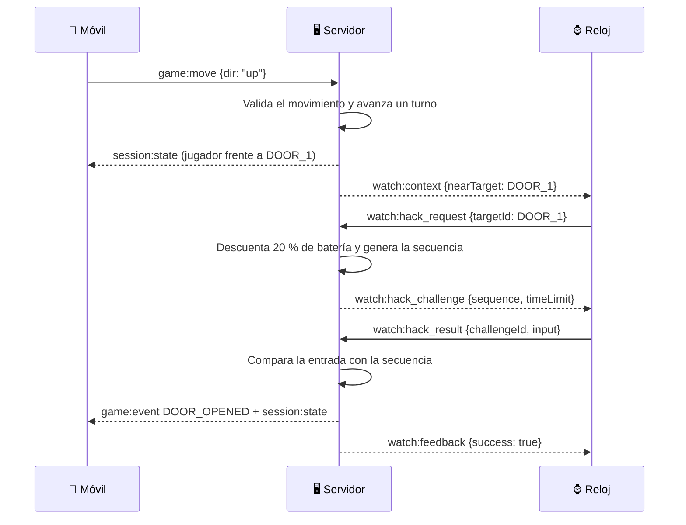

# NEXO — Documento de Contexto para Asistentes de IA

> **Para la IA que lee esto:** este documento es la **fuente única de verdad** del proyecto NEXO. Contiene las decisiones ya tomadas, la arquitectura, las reglas del juego, el esquema de base de datos, los contratos de comunicación (API y eventos en tiempo real) y lo que le toca a cada integrante del equipo. Antes de escribir código, lee la sección **0. Reglas para la IA**. Si algo no está definido aquí, **pregunta antes de inventarlo**.

---

## Índice
0. [Reglas para la IA](#0-reglas-para-la-ia)
1. [Resumen del proyecto](#1-resumen-del-proyecto)
2. [Decisiones cerradas (no cambiar)](#2-decisiones-cerradas-no-cambiar)
3. [Arquitectura del sistema](#3-arquitectura-del-sistema)
4. [Diseño del juego](#4-diseño-del-juego)
5. [Niveles](#5-niveles)
6. [Habilidades del reloj](#6-habilidades-del-reloj)
7. [Progresión y mejoras](#7-progresión-y-mejoras)
8. [Modo online](#8-modo-online)
9. [Pantallas](#9-pantallas)
10. [Base de datos (MySQL)](#10-base-de-datos-mysql)
11. [API REST](#11-api-rest)
12. [Eventos en tiempo real (Socket.io)](#12-eventos-en-tiempo-real-socketio)
13. [Formato de los mapas (JSON)](#13-formato-de-los-mapas-json)
14. [Estilo visual](#14-estilo-visual)
15. [Infraestructura (VPS Hostinger)](#15-infraestructura-vps-hostinger)
16. [Estructura del repositorio](#16-estructura-del-repositorio)
17. [Equipo: qué hace cada integrante](#17-equipo-qué-hace-cada-integrante)
18. [Plan de 7 días](#18-plan-de-7-días)
19. [Riesgos conocidos y cómo evitarlos](#19-riesgos-conocidos-y-cómo-evitarlos)

---

## 0. Reglas para la IA

1. **El servidor manda (server-authoritative).** Toda la lógica del juego (movimiento válido, batería, alerta, detección, victoria/derrota, validación de hackeos) se calcula en el **backend**. El móvil y el reloj solo envían **intenciones** (`"quiero moverme arriba"`, `"quiero usar escáner"`) y dibujan el estado que les manda el servidor.
2. **Respeta los contratos.** Los nombres de tablas, endpoints, eventos y campos de este documento son el acuerdo entre los 3 integrantes. Si necesitas cambiar uno, **avisa explícitamente** y propone actualizar este documento.
3. **Idiomas:** el código (variables, funciones, tablas, eventos) va en **inglés**. Los textos que ve el jugador van en **español**.
4. **TypeScript** en backend y en Expo. **Kotlin + Jetpack Compose for Wear OS** en el reloj.
5. **Nada de credenciales en las apps.** Las apps nunca se conectan a MySQL; solo hablan con la API por HTTPS/WSS.
6. **Código simple y explicable.** Es un proyecto escolar; el equipo debe poder explicar cada parte al profesor. Prefiere claridad sobre trucos.
7. **Si algo no está definido, pregunta.**

---

## 1. Resumen del proyecto

**NEXO** es un juego de **estrategia e infiltración** para **móvil + smartwatch**, ambientado en una ciudad cyberpunk dividida en distritos. El jugador completa misiones de infiltración, consigue recursos (**Créditos, Energía e Información**), mejora su equipo y, en el modo online, coopera con otro jugador o asalta bases creadas por otros.

### La idea central
- **El móvil es el campo de juego:** mapa 2D por casillas, movimiento del personaje, enemigos, inventario, base y mejoras.
- **El reloj es la herramienta de hacker ("Hacker Deck"):** escanea trampas, desactiva cámaras, oculta tu señal y resuelve minijuegos para abrir puertas. Todo gasta una **batería compartida**.
- **Lo que haces en el reloj cambia lo que pasa en el móvil**, en tiempo real. Ejemplo: frente a una puerta bloqueada puedes rodear (y arriesgarte con los guardias) o gastar batería para hackearla en el reloj. Si aciertas, la puerta se abre en el móvil; si fallas, sube la alerta.

### Contexto académico
- Proyecto escolar de un equipo de **3 integrantes**, con **1 semana** de plazo.
- Requisitos de la materia: app móvil + app de smartwatch + **base de datos** + **interacción entre ambos dispositivos**. Tema libre excepto salud.

---

## 2. Decisiones cerradas (no cambiar)

| Tema | Decisión |
| :--- | :--- |
| App móvil | **React Native con Expo** (TypeScript, `expo-router`) |
| App del reloj | **Wear OS nativo**: Kotlin + Jetpack Compose for Wear OS (Android Studio) |
| Backend | **Node.js 20 + Express + Socket.io** (TypeScript) |
| Base de datos | **MySQL 8** |
| Servidor | **VPS de Hostinger** (Ubuntu 24.04 LTS) |
| HTTPS (gratis) | Subdominio gratis de **DuckDNS** + **Caddy** (certificado automático de Let's Encrypt) |
| Movimiento en el mapa | **Por casillas y por turnos**: el mundo solo avanza cuando el jugador se mueve o espera. Así puede mirar el reloj sin que lo atrapen. |
| Minijuego base del reloj | **Secuencia de nodos** (tipo "Simón Dice") de 4 nodos de colores |
| Fallo / alerta | **Barra de alerta de 0 a 100 %**. Al llegar a 100 % hay *Lockdown* y la misión se pierde. |
| Batería | Solo las habilidades del reloj gastan batería. En el mapa hay **nodos de energía** opcionales que recargan. |
| Mejoras principales | Mejorar el **Hacker Deck** (más batería, hackeos más fáciles, habilidades más baratas) |
| Vinculación móvil–reloj | **Código de 4 dígitos** que muestra el reloj y se escribe en el móvil (no se escriben contraseñas en el reloj) |
| Comunicación móvil–reloj | **Siempre a través del servidor** (Wi-Fi/Internet). **No se usa Bluetooth** ni la Wearable Data Layer API. |
| PvP | **100 % asíncrono**: el atacante juega contra las defensas automáticas que dejó el dueño. **Sin notificaciones push.** El dueño ve un reporte al volver a entrar. |
| Dispositivos del equipo | Relojes físicos + emuladores. Hay **al menos un iPhone** (solo corre la app móvil con Expo Go; su reloj se conecta por Wi-Fi propio). |

---

## 3. Arquitectura del sistema



### Principios
- **Estado en memoria + guardado en MySQL.** Cada partida activa vive en la memoria del servidor (rápido). En eventos importantes (puerta abierta, cambio de alerta, fin de partida) se guarda una copia en MySQL para no perder nada si el servidor se reinicia.
- **Salas de Socket.io:**
  - `player:{playerId}`: une el móvil y el reloj del mismo jugador.
  - `session:{sessionId}`: une a todos los dispositivos de una partida (2 en solo, 4 en co-op).
- **Autenticación con JWT.** El móvil recibe un token con `role: "mobile"`. El reloj, después de vincularse, recibe un token con `role: "watch"`. Ambos llevan el mismo `playerId`.

### Flujo típico: hackear una puerta



---

## 4. Diseño del juego

### 4.1 Turnos
- Cada **movimiento** (arriba, abajo, izquierda, derecha) o **Esperar** = **1 turno**.
- Al final de cada turno: los guardias y drones avanzan un paso de su ruta, las cámaras giran si son rotativas y bajan los contadores de los efectos.
- **Usar habilidades o hackear NO gasta turno.** El mundo espera al jugador.

### 4.2 Batería
- Empieza en **100 %** (o más, según las mejoras). Solo la gastan las habilidades del reloj.
- **Nodo de energía** en el mapa: **+30 %** (sin pasar del máximo); desaparece al tomarlo.
- Si no alcanza la batería, el reloj muestra la habilidad bloqueada.

### 4.3 Alerta (0–100 %)
| Causa | Alerta |
| :--- | :---: |
| Terminar el turno dentro del cono de una cámara activa | +35 |
| Terminar el turno dentro del cono de un guardia | +50 |
| Pisar una trampa (además queda revelada) | +25 |
| Fallar un hackeo | +35 |
| Nivel 5: alerta pasiva | +3 cada 5 turnos |

| Rango | Estado | Efecto |
| :--- | :--- | :--- |
| 0–49 | 🟦 Sigilo | Normal |
| 50–99 | 🟧 Sospecha | El reloj vibra de aviso; los conos de visión crecen **+1 casilla** |
| 100 | 🟥 Lockdown | Misión perdida. El jugador conserva el **50 %** de lo que recogió. |

**El camuflaje** evita sumar alerta por cámaras y guardias mientras dura (no protege de las trampas).

### 4.4 Victoria
Llegar a la casilla de **extracción** (🏁). Se otorgan las recompensas del nivel + lo recogido en terminales.

### 4.5 Recursos
- **Créditos (💳):** moneda general.
- **Energía (⚡):** para mejoras de batería.
- **Información (💾):** para mejoras de hackeo.

---

## 5. Niveles

| # | Nombre / Temática | Mapa | Obstáculos nuevos | Minijuego de puertas | Desbloquea | Recompensa base (💳/⚡/💾) |
| :-: | :--- | :-: | :--- | :--- | :--- | :-: |
| 1 | **Bóveda Central** — Robo al banco | 8×8 | Cámaras fijas (cono de 2 casillas), puerta acorazada | Secuencia de 4 nodos | Sobrecarga de Bóveda | 150 / 40 / 15 |
| 2 | **Cripta del Coleccionista** — Búsqueda del tesoro | 9×9 | Trampas invisibles; sensor de presión (+alerta si pisas la misma baldosa 2 veces seguidas); tesoro oculto opcional | Alineación de glifos (girar 3 anillos) | Radar de Frecuencia | 220 / 55 / 25 |
| 3 | **Complejo Neuro-Link** — Laboratorio de IA | 10×10 | Drones con ruta circular; zonas PEM (bloquean el reloj 2 turnos) | Ondas sinusoidales (tocar cuando se cruzan) | Pulso PEM | 300 / 70 / 35 |
| 4 | **Nido de Servidores** — Apagón | 10×10 | Niebla de guerra (solo se ve 1 casilla alrededor); terminales que se queman a los 15 s reales | Secuencia rápida de 5 nodos con tiempo límite | Visión Térmica | 400 / 90 / 50 |
| 5 | **Fortaleza Orbital** — Mega-corporación | 12×12 | Torretas 360°; puerta de cerrojo dual (2 hackeos seguidos); alerta pasiva | Sobrecarga de núcleo (mantener y soltar en la marca) | Dilatación Temporal | 550 / 120 / 70 |

- Cada nivel se desbloquea al completar el anterior.
- La dificultad del minijuego también depende de la mejora **Chip Desencriptador** (ver 7).
- Los mapas se guardan como JSON en la tabla `missions` (ver 13).

---

## 6. Habilidades del reloj

### 6.1 Iniciales (disponibles desde el principio)
| Código | Nombre | Batería | Efecto |
| :--- | :--- | :-: | :--- |
| `SCANNER` | 📡 Escáner de Pulso | 15 % | Revela trampas en un radio de 3 casillas durante 3 turnos |
| `SABOTAGE` | 📷 Sabotaje Óptico | 25 % | Apaga la cámara más cercana durante 3 turnos |
| `CAMOUFLAGE` | 👻 Camuflaje de Señal | 35 % | No sumas alerta por cámaras y guardias durante 2 turnos |
| `HACK` | 🔓 Hackear | 20 % | Solo aparece frente a una puerta o terminal. Abre el minijuego. **Siempre equipada.** |

### 6.2 Desbloqueables (una por nivel)
| Código | Nombre | Batería | Efecto | Se desbloquea en |
| :--- | :--- | :-: | :--- | :-: |
| `OVERLOAD` | ⚡ Sobrecarga de Bóveda | 20 % | Apaga los láseres en un radio de 4 casillas durante 2 turnos | Nivel 1 |
| `RADAR` | 📡 Radar de Frecuencia | 15 % | El reloj muestra una brújula y vibra más rápido al acercarte al tesoro u objetivo | Nivel 2 |
| `EMP` | 🧲 Pulso PEM | 30 % | Paraliza al dron más cercano durante 4 turnos | Nivel 3 |
| `THERMAL` | 👁️ Visión Térmica | 25 % | Quita la niebla y muestra enemigos a través de paredes durante 3 turnos | Nivel 4 |
| `TIMEDILATE` | ⏱️ Dilatación Temporal | 40 % | Congela enemigos y cámaras durante 2 turnos | Nivel 5 |

- El jugador puede **equipar hasta 4 habilidades** (además de `HACK`), elegidas en el Taller del móvil.

---

## 7. Progresión y mejoras

Las mejoras se compran en el **Taller** de la app móvil y cambian cómo funciona el reloj.

| Mejora | Nivel 1 | Nivel 2 | Nivel 3 |
| :--- | :--- | :--- | :--- |
| 🔋 **Batería de Alta Capacidad** (`battery_level`) | Máx. 100 % | Máx. 125 % — cuesta 150 💳 + 40 ⚡ | Máx. 150 % — cuesta 300 💳 + 80 ⚡ |
| 🧠 **Chip Desencriptador** (`cipher_level`) | Normal | Secuencias más cortas (4→3 nodos) — cuesta 20 💾 | Además, el patrón se muestra más lento — cuesta 45 💾 |
| ⚡ **Optimizador de Pulso** (`efficiency_level`) | Normal | −5 % al costo de las habilidades — cuesta 100 💳 + 30 ⚡ | −10 % — cuesta 200 💳 + 60 ⚡ |

Recursos iniciales de una cuenta nueva: **100 💳, 50 ⚡, 10 💾**.

---

## 8. Modo online

### 8.1 Co-op: 2 jugadores en la misma partida (4 dispositivos)
- El jugador A crea una sala desde el móvil y recibe un código (`NX-4821`). El jugador B lo escribe en su móvil. Los relojes de ambos se conectan solos porque ya están vinculados a su cuenta.
- Los dos personajes aparecen en el mismo mapa. **Cada uno tiene su propia batería y sus habilidades.** La **alerta es compartida**.
- **Turnos:** el mundo avanza cuando **ambos** jugadores han hecho su acción del turno (moverse o esperar).
- **Cerrojo dual:** algunas puertas tienen 2 terminales. Cuando cada jugador está en una, el servidor lanza el minijuego a **los dos relojes a la vez**. Hay **5 segundos** de diferencia máxima entre ambos aciertos. Si los dos aciertan, la puerta se abre.
- **Transferir batería:** un jugador puede darle **25 %** de su batería al otro desde el reloj.
- **Pings silenciosos:** desde el reloj se mandan avisos rápidos (`DANGER`, `WAIT`, `GO`, `HELP`) que hacen vibrar el reloj del compañero.
- La victoria requiere que **los dos** lleguen a la extracción.

### 8.2 PvP asíncrono: asalto a bases personalizadas
- **Editor de base (móvil):** cada jugador diseña su base en una cuadrícula de 10×10: muros, cámaras, guardias con ruta, trampas, puertas hackeables y su **bóveda**. Cada pieza cuesta créditos.
- **Validación:** antes de publicar, el editor y el servidor revisan con **BFS** que exista al menos un camino posible desde la entrada hasta la bóveda (contando las puertas como cruzables). Si no lo hay, no se puede publicar.
- **Asalto:** otro jugador elige una base de una lista y la juega como un nivel normal, usando su reloj. Las defensas son automáticas (el dueño no está jugando).
- **Botín:** si el atacante llega a la bóveda y extrae, se lleva el **30 %** de los créditos guardados en la bóveda del defensor.
- **Reporte:** cuando el defensor vuelve a abrir la app, ve qué pasó: quién atacó, si lo frenaron y cuánto le robaron. **No hay notificaciones push.**

---

## 9. Pantallas

### 9.1 App móvil (Expo)
| Pantalla | Ruta sugerida | Contenido |
| :--- | :--- | :--- |
| Login / Registro | `/(auth)/login`, `/(auth)/register` | Usuario, correo y contraseña |
| Vincular reloj | `/pair` | Campo para el código de 4 dígitos + estado del reloj (conectado o no) |
| Hub / Distritos | `/(tabs)/index` | Recursos arriba, lista de niveles (bloqueados o disponibles), botón **Iniciar** |
| Taller | `/(tabs)/workshop` | Las 3 mejoras con su costo + equipar habilidades |
| Online | `/(tabs)/online` | Crear o unirse a una sala co-op; lista de bases para asaltar; reportes de asaltos |
| Mi Base | `/(tabs)/base` | Editor de cuadrícula de la base PvP |
| Perfil | `/(tabs)/profile` | Estadísticas e historial de misiones |
| Juego | `/game/[sessionId]` | HUD (batería, alerta, aviso del reloj) + mapa + cruceta + botón Esperar |
| Resultado | modal | Victoria o derrota, recompensas y botón **Volver a la base** |

### 9.2 App del reloj (Wear OS)
| Pantalla | Contenido |
| :--- | :--- |
| Vinculación | Muestra el código de 4 dígitos y espera a que el móvil lo confirme |
| En espera | "Sin misión activa" + recursos del jugador |
| Deck táctico | Arco de batería (cian) y arco de alerta (ámbar o rojo) + botones de las habilidades equipadas. El botón **Hackear** aparece cuando hay una puerta o terminal al lado. |
| Minijuego | Depende del nivel (ver 5). Vibra al acertar o fallar. |
| Co-op | Botones de ping y de transferir batería; aviso de cerrojo dual |
| Resultado | Victoria o derrota |

**Vibraciones:** éxito = 1 pulso corto · fallo = 2 pulsos fuertes · paso a Sospecha = 3 pulsos · ping del compañero = 2 pulsos cortos.

---

## 10. Base de datos (MySQL)

> Este esquema reemplaza las versiones anteriores (`active_sessions`, `online_match_sessions`). Una sola tabla de sesiones sirve para solo, co-op y asaltos.

```sql
CREATE DATABASE IF NOT EXISTS nexo_db CHARACTER SET utf8mb4 COLLATE utf8mb4_unicode_ci;
USE nexo_db;

-- Jugadores y recursos
CREATE TABLE players (
  id INT AUTO_INCREMENT PRIMARY KEY,
  username VARCHAR(30) NOT NULL UNIQUE,
  email VARCHAR(120) NOT NULL UNIQUE,
  password_hash VARCHAR(255) NOT NULL,
  credits INT NOT NULL DEFAULT 100,
  energy INT NOT NULL DEFAULT 50,
  intel INT NOT NULL DEFAULT 10,
  created_at TIMESTAMP DEFAULT CURRENT_TIMESTAMP
);

-- Relojes vinculados a un jugador
CREATE TABLE watch_devices (
  id INT AUTO_INCREMENT PRIMARY KEY,
  player_id INT NOT NULL,
  device_name VARCHAR(80),
  linked_at TIMESTAMP DEFAULT CURRENT_TIMESTAMP,
  last_seen_at TIMESTAMP NULL,
  FOREIGN KEY (player_id) REFERENCES players(id) ON DELETE CASCADE
);

-- Códigos temporales de vinculación (los pide el reloj, los confirma el móvil)
CREATE TABLE pairing_codes (
  id INT AUTO_INCREMENT PRIMARY KEY,
  code CHAR(4) NOT NULL,
  pairing_token CHAR(36) NOT NULL UNIQUE,   -- lo guarda el reloj para preguntar el estado
  player_id INT NULL,                       -- se llena cuando el móvil confirma
  expires_at TIMESTAMP NOT NULL,            -- 5 minutos
  claimed_at TIMESTAMP NULL,
  INDEX (code),
  FOREIGN KEY (player_id) REFERENCES players(id) ON DELETE CASCADE
);

-- Mejoras del Hacker Deck
CREATE TABLE player_upgrades (
  player_id INT PRIMARY KEY,
  battery_level TINYINT NOT NULL DEFAULT 1,
  cipher_level TINYINT NOT NULL DEFAULT 1,
  efficiency_level TINYINT NOT NULL DEFAULT 1,
  FOREIGN KEY (player_id) REFERENCES players(id) ON DELETE CASCADE
);

-- Habilidades desbloqueadas y equipadas
CREATE TABLE player_skills (
  player_id INT NOT NULL,
  skill_code VARCHAR(20) NOT NULL,   -- SCANNER, SABOTAGE, CAMOUFLAGE, OVERLOAD, RADAR, EMP, THERMAL, TIMEDILATE
  equipped BOOLEAN NOT NULL DEFAULT FALSE,
  unlocked_at TIMESTAMP DEFAULT CURRENT_TIMESTAMP,
  PRIMARY KEY (player_id, skill_code),
  FOREIGN KEY (player_id) REFERENCES players(id) ON DELETE CASCADE
);

-- Catálogo de niveles
CREATE TABLE missions (
  id INT AUTO_INCREMENT PRIMARY KEY,
  level_number TINYINT NOT NULL UNIQUE,
  name VARCHAR(80) NOT NULL,
  theme VARCHAR(40) NOT NULL,              -- BANK, CRYPT, LAB, SERVERS, ORBITAL
  map_json JSON NOT NULL,                  -- ver sección 13
  reward_credits INT NOT NULL,
  reward_energy INT NOT NULL,
  reward_intel INT NOT NULL,
  unlocks_skill VARCHAR(20) NULL,
  supports_coop BOOLEAN NOT NULL DEFAULT TRUE
);

-- Progreso por nivel
CREATE TABLE player_mission_progress (
  player_id INT NOT NULL,
  mission_id INT NOT NULL,
  completed BOOLEAN NOT NULL DEFAULT FALSE,
  best_turns INT NULL,
  times_played INT NOT NULL DEFAULT 0,
  PRIMARY KEY (player_id, mission_id),
  FOREIGN KEY (player_id) REFERENCES players(id) ON DELETE CASCADE,
  FOREIGN KEY (mission_id) REFERENCES missions(id) ON DELETE CASCADE
);

-- Bases PvP creadas por los jugadores
CREATE TABLE player_bases (
  id INT AUTO_INCREMENT PRIMARY KEY,
  owner_id INT NOT NULL UNIQUE,            -- una base por jugador
  name VARCHAR(60) NOT NULL,
  map_json JSON NOT NULL,                  -- mismo formato que las misiones
  vault_credits INT NOT NULL DEFAULT 0,
  is_published BOOLEAN NOT NULL DEFAULT FALSE,
  times_raided INT NOT NULL DEFAULT 0,
  times_defended INT NOT NULL DEFAULT 0,
  updated_at TIMESTAMP DEFAULT CURRENT_TIMESTAMP ON UPDATE CURRENT_TIMESTAMP,
  FOREIGN KEY (owner_id) REFERENCES players(id) ON DELETE CASCADE
);

-- Partidas (solo, co-op y asaltos)
CREATE TABLE game_sessions (
  id CHAR(36) PRIMARY KEY,                 -- UUID
  room_code VARCHAR(10) NULL UNIQUE,       -- solo co-op, ej. NX-4821
  type ENUM('SOLO','COOP','RAID') NOT NULL,
  mission_id INT NULL,
  base_id INT NULL,
  status ENUM('WAITING','PLAYING','WON','LOST','ABANDONED') NOT NULL DEFAULT 'WAITING',
  turn INT NOT NULL DEFAULT 0,
  alert_level TINYINT NOT NULL DEFAULT 0,
  state_json JSON NULL,                    -- copia del estado en memoria (puertas, enemigos, efectos)
  created_at TIMESTAMP DEFAULT CURRENT_TIMESTAMP,
  ended_at TIMESTAMP NULL,
  FOREIGN KEY (mission_id) REFERENCES missions(id),
  FOREIGN KEY (base_id) REFERENCES player_bases(id) ON DELETE SET NULL
);

-- Jugadores dentro de cada partida
CREATE TABLE session_players (
  session_id CHAR(36) NOT NULL,
  player_id INT NOT NULL,
  slot TINYINT NOT NULL,                   -- 1 o 2
  pos_x TINYINT NOT NULL DEFAULT 0,
  pos_y TINYINT NOT NULL DEFAULT 0,
  battery SMALLINT NOT NULL DEFAULT 100,
  max_battery SMALLINT NOT NULL DEFAULT 100,
  loot_credits INT NOT NULL DEFAULT 0,
  loot_energy INT NOT NULL DEFAULT 0,
  loot_intel INT NOT NULL DEFAULT 0,
  extracted BOOLEAN NOT NULL DEFAULT FALSE,
  PRIMARY KEY (session_id, player_id),
  FOREIGN KEY (session_id) REFERENCES game_sessions(id) ON DELETE CASCADE,
  FOREIGN KEY (player_id) REFERENCES players(id) ON DELETE CASCADE
);

-- Historial de misiones terminadas
CREATE TABLE mission_history (
  id INT AUTO_INCREMENT PRIMARY KEY,
  session_id CHAR(36) NOT NULL,
  player_id INT NOT NULL,
  mission_id INT NULL,
  type ENUM('SOLO','COOP','RAID') NOT NULL,
  result ENUM('WON','LOST') NOT NULL,
  turns INT NOT NULL,
  max_alert TINYINT NOT NULL,
  hacks_ok INT NOT NULL DEFAULT 0,
  hacks_failed INT NOT NULL DEFAULT 0,
  credits_earned INT NOT NULL DEFAULT 0,
  energy_earned INT NOT NULL DEFAULT 0,
  intel_earned INT NOT NULL DEFAULT 0,
  played_at TIMESTAMP DEFAULT CURRENT_TIMESTAMP,
  FOREIGN KEY (player_id) REFERENCES players(id) ON DELETE CASCADE
);

-- Reportes de asaltos PvP
CREATE TABLE raid_reports (
  id INT AUTO_INCREMENT PRIMARY KEY,
  session_id CHAR(36) NOT NULL,
  attacker_id INT NOT NULL,
  defender_id INT NOT NULL,
  base_id INT NOT NULL,
  success BOOLEAN NOT NULL,
  credits_stolen INT NOT NULL DEFAULT 0,
  seen_by_defender BOOLEAN NOT NULL DEFAULT FALSE,
  created_at TIMESTAMP DEFAULT CURRENT_TIMESTAMP,
  FOREIGN KEY (attacker_id) REFERENCES players(id) ON DELETE CASCADE,
  FOREIGN KEY (defender_id) REFERENCES players(id) ON DELETE CASCADE
);
```

**Al registrarse**, el servidor crea: la fila en `player_upgrades`, las 3 habilidades iniciales en `player_skills` (equipadas) y la fila del nivel 1 en `player_mission_progress`.

---

## 11. API REST

Base: `https://<subdominio>.duckdns.org/api` · Respuestas en JSON · Token en el encabezado `Authorization: Bearer <jwt>`.

| Método | Ruta | Quién | Descripción |
| :--- | :--- | :--- | :--- |
| POST | `/auth/register` | Móvil | `{username, email, password}` → `{token, player}` |
| POST | `/auth/login` | Móvil | `{email, password}` → `{token, player}` |
| GET | `/me` | Ambos | Jugador, recursos, mejoras, habilidades y relojes vinculados |
| POST | `/pairing/code` | Reloj (sin token) | → `{code, pairingToken, expiresAt}` |
| GET | `/pairing/status/:pairingToken` | Reloj | → `{status: "PENDING"}` o `{status: "LINKED", watchToken, player}` |
| POST | `/pairing/claim` | Móvil | `{code}` → vincula el reloj a la cuenta |
| GET | `/missions` | Móvil | Niveles con su estado (bloqueado, disponible o completado) |
| POST | `/sessions/solo` | Móvil | `{missionId}` → `{sessionId}` |
| POST | `/coop/rooms` | Móvil | `{missionId}` → `{sessionId, roomCode}` |
| POST | `/coop/rooms/:roomCode/join` | Móvil | → `{sessionId}` |
| GET | `/upgrades` | Móvil | Niveles actuales y costo del siguiente |
| POST | `/upgrades/:type/buy` | Móvil | `type`: `battery`, `cipher` o `efficiency` |
| PUT | `/skills/equip` | Móvil | `{skills: ["SCANNER","EMP",...]}` (máximo 4) |
| GET | `/base` | Móvil | Base propia |
| PUT | `/base` | Móvil | `{name, mapJson}` → guarda el borrador |
| POST | `/base/publish` | Móvil | Valida con BFS y publica |
| GET | `/raids/targets` | Móvil | Lista de bases publicadas de otros jugadores |
| POST | `/raids/start` | Móvil | `{baseId}` → `{sessionId}` |
| GET | `/raids/reports` | Móvil | Reportes nuevos de asaltos a mi base |
| GET | `/history` | Móvil | Historial de misiones |

**Errores:** `{ "error": { "code": "NOT_ENOUGH_CREDITS", "message": "No tienes créditos suficientes" } }`

---

## 12. Eventos en tiempo real (Socket.io)

Conexión: `wss://<subdominio>.duckdns.org` con `auth: { token }`. Al conectar, el servidor mete el socket en `player:{playerId}`.

### Del cliente al servidor
| Evento | Quién | Datos | Descripción |
| :--- | :--- | :--- | :--- |
| `session:join` | Ambos | `{sessionId}` | Entra a la sala de la partida y recibe el estado completo |
| `game:move` | Móvil | `{dir: "up"\|"down"\|"left"\|"right"}` | Intención de moverse |
| `game:wait` | Móvil | `{}` | Pasar el turno |
| `watch:skill` | Reloj | `{skill}` | Usar una habilidad |
| `watch:hack_request` | Reloj | `{targetId}` | Pedir el minijuego de una puerta o terminal |
| `watch:hack_result` | Reloj | `{challengeId, input}` | Respuesta del jugador al minijuego |
| `coop:ping` | Reloj | `{type: "DANGER"\|"WAIT"\|"GO"\|"HELP"}` | Aviso al compañero |
| `coop:transfer_battery` | Reloj | `{}` | Dar 25 % de batería al compañero |
| `session:leave` | Móvil | `{}` | Abandonar la partida |

### Del servidor al cliente
| Evento | Para | Datos | Descripción |
| :--- | :--- | :--- | :--- |
| `pairing:linked` | Móvil | `{watch}` | El reloj quedó vinculado |
| `session:state` | Todos | Estado completo | Se manda después de cada cambio. Es lo único que el móvil necesita para dibujar. |
| `watch:context` | Reloj | `{battery, maxBattery, alert, nearTarget, skills: [{code, cost, available, reason?}]}` | Lo que el reloj necesita para su pantalla |
| `watch:hack_challenge` | Reloj | `{challengeId, minigame, params, expiresAt}` | Inicia el minijuego. `params` depende del minijuego (ej. `{sequence: [2,0,3,1], showMs: 600}`). |
| `watch:feedback` | Reloj | `{type: "SUCCESS"\|"FAIL"\|"ALERT_UP"\|"PING", data}` | Para vibrar y mostrar mensajes |
| `game:event` | Todos | `{type, data}` | Eventos para animar: `DOOR_OPENED`, `CAMERA_DISABLED`, `DETECTED`, `TRAP_TRIGGERED`, `ENERGY_PICKED`, `LOOT_PICKED`, `SKILL_USED`, `LOCKDOWN` |
| `coop:dual_hack_start` | Relojes | `{doorId, challengeId, params, expiresAt}` | Cerrojo dual |
| `game:ended` | Todos | `{result, rewards, unlockedSkill?}` | Fin de la partida |
| `error` | Quien lo causó | `{code, message}` | Acción inválida |

### Forma de `session:state`
```json
{
  "sessionId": "uuid",
  "type": "SOLO",
  "turn": 12,
  "alert": 35,
  "status": "PLAYING",
  "theme": "BANK",
  "width": 8,
  "height": 8,
  "tiles": [[1,1,1,1,1,1,1,1], [1,6,0,0,2,0,5,1], "..."],
  "players": [{ "playerId": 7, "slot": 1, "x": 3, "y": 1, "battery": 80, "maxBattery": 100, "camouflageTurns": 0 }],
  "entities": [
    { "id": "CAM_1", "type": "camera", "x": 5, "y": 2, "dir": "down", "range": 2, "disabledTurns": 0, "visionTiles": [[5,3],[5,4]] },
    { "id": "DOOR_1", "type": "door", "x": 4, "y": 1, "open": false, "minigame": "SEQUENCE" },
    { "id": "EN_1", "type": "energy", "x": 1, "y": 5 }
  ],
  "revealedTraps": [],
  "fog": null
}
```
El servidor calcula `visionTiles` para que el móvil solo tenga que pintarlas.

---

## 13. Formato de los mapas (JSON)

Lo usan `missions.map_json` y `player_bases.map_json`.

```json
{
  "width": 8,
  "height": 8,
  "theme": "BANK",
  "tiles": [
    [1,1,1,1,1,1,1,1],
    [1,6,0,0,2,0,5,1],
    [1,0,1,0,1,0,0,1],
    [1,0,0,0,0,0,0,1],
    [1,4,1,1,0,1,0,1],
    [1,0,0,0,0,0,7,1],
    [1,0,0,0,0,0,0,1],
    [1,1,1,1,1,1,1,1]
  ],
  "entities": [
    { "id": "CAM_1", "type": "camera", "x": 3, "y": 2, "dir": "down", "range": 2, "rotating": false },
    { "id": "GRD_1", "type": "guard", "path": [[2,3],[3,3],[4,3],[3,3]], "range": 2 },
    { "id": "TRP_1", "type": "trap", "x": 5, "y": 3, "hidden": true },
    { "id": "DOOR_1", "type": "door", "x": 4, "y": 1, "minigame": "SEQUENCE" },
    { "id": "TERM_1", "type": "terminal", "x": 6, "y": 5, "loot": { "credits": 50, "intel": 5 } },
    { "id": "EN_1", "type": "energy", "x": 1, "y": 4, "amount": 30 }
  ]
}
```

**Códigos de `tiles`:** `0` piso · `1` muro · `2` puerta (detalles en `entities`) · `4` nodo de energía · `5` extracción · `6` inicio (en co-op, `6` = jugador 1 y `8` = jugador 2) · `7` terminal · `9` vacío/abismo.

**Tipos de entidades:** `camera`, `guard`, `drone`, `turret`, `trap`, `door`, `dual_door` (lleva `terminals: [[x,y],[x,y]]`), `terminal`, `energy`, `emp_zone`, `treasure`, `vault` (solo en bases PvP).

**Minijuegos:** `SEQUENCE`, `GLYPHS`, `WAVES`, `FAST_SEQUENCE`, `CORE_OVERLOAD`.

---

## 14. Estilo visual

**Estilo base: "Holograma táctico neón"** (cyberpunk oscuro). Cada nivel cambia el color de acento.

| Uso | Color |
| :--- | :--- |
| Fondo | `#060913` |
| Paneles | `#111827` (con transparencia) |
| Acento principal / sigilo | `#00F0FF` |
| Sospecha | `#FF9900` |
| Alerta / Lockdown | `#FF003C` |
| Éxito | `#00FF66` |

| Nivel | Acento |
| :--- | :--- |
| 1 Banco | Dorado `#FFD700` |
| 2 Cripta | Esmeralda `#00FF87` |
| 3 Laboratorio | Cian `#00E5FF` |
| 4 Servidores | Púrpura `#BD00FF` |
| 5 Orbital | Carmesí `#FF003C` |

**Librerías del móvil:** `moti` + `react-native-reanimated` (animaciones), `@shopify/react-native-skia` (brillo neón y conos), `lucide-react-native` (íconos), `lottie-react-native` (animaciones de LottieFiles), `socket.io-client`, `axios`, `expo-secure-store` (guardar el token), `expo-haptics`.

**Librerías del reloj:** Compose for Wear OS (`androidx.wear.compose`), `io.socket:socket.io-client`, Retrofit + OkHttp, DataStore (guardar el token), `Vibrator`/`VibratorManager`, `lottie-compose` (opcional).

**Efectos sincronizados obligatorios:**
1. Al usar el **Escáner** en el reloj, una onda sale del personaje en el móvil.
2. El móvil y el reloj cambian de color al mismo tiempo según la alerta.
3. Al abrir una puerta, el láser pasa de rojo a verde con una animación.

---

## 15. Infraestructura (VPS Hostinger)

| Componente | Detalle |
| :--- | :--- |
| Sistema | Ubuntu 24.04 LTS |
| Node.js | v20 LTS, proceso manejado con **PM2** (`pm2 start dist/index.js --name nexo-api`) |
| MySQL | 8.x, solo escucha en `localhost`. Usuario `nexo_user` con permisos solo sobre `nexo_db`. |
| Caddy | Proxy inverso con HTTPS automático. Config: `<sub>.duckdns.org { reverse_proxy localhost:3000 }` |
| DNS | Subdominio gratis en duckdns.org apuntando a la IP del VPS |
| Firewall | Abrir **22, 80 y 443** (en el panel de Hostinger y en `ufw`). **No** abrir el 3000 ni el 3306. |
| Variables (`.env`) | `PORT=3000`, `DB_HOST=localhost`, `DB_USER`, `DB_PASSWORD`, `DB_NAME=nexo_db`, `JWT_SECRET` |

**Por qué HTTPS es obligatorio:** Android (desde la versión 9) e iOS bloquean las conexiones `http` sin cifrar.

**Desarrollo local:** se puede correr el backend en una laptop y exponerlo con `ngrok` o `cloudflared` para probar desde los dispositivos.

---

## 16. Estructura del repositorio

Un solo repositorio en GitHub (monorepo):

```
nexo/
├── backend/            # Node + Express + Socket.io (TypeScript)
│   ├── src/
│   │   ├── index.ts
│   │   ├── config/     # env, conexión MySQL (mysql2/promise)
│   │   ├── routes/     # auth, pairing, missions, upgrades, skills, base, raids, history
│   │   ├── sockets/    # handlers de eventos
│   │   ├── game/       # motor: turnos, visión, habilidades, minijuegos, BFS
│   │   └── db/         # consultas
│   ├── sql/
│   │   ├── schema.sql
│   │   └── seed_missions.sql
│   └── .env.example
├── mobile/             # Expo (expo-router)
│   ├── app/            # pantallas
│   ├── components/     # Board, Tile, Hud, DPad, ...
│   ├── lib/            # api.ts, socket.ts, config.ts
│   └── theme/          # colores por nivel
├── wear/               # Proyecto de Android Studio (Wear OS)
│   └── app/src/main/java/.../nexo/
│       ├── ui/         # pantallas Compose
│       ├── data/       # Retrofit, Socket, DataStore
│       └── haptics/
└── docs/
    └── NEXO_Contexto_IA.md   # este documento
```

**Ramas:** `main` (estable) y una rama por integrante (`feat/mobile`, `feat/wear`, `feat/backend`). Se hace merge a `main` cuando algo funciona.

---

## 17. Equipo: qué hace cada integrante

### 👤 Integrante 1 — Móvil: campo de juego y online
**Rol:** dueño de la experiencia de juego en el teléfono. Todo lo que el jugador ve y toca durante una misión.

**Responsabilidades:**
- **Proyecto Expo:** crearlo con TypeScript y `expo-router`, el tema de colores y los clientes de API y Socket.io (`lib/`).
- **Login, registro y vinculación del reloj:** pantallas y guardado seguro del token.
- **Tablero 2D:** dibujar `tiles` y `entities` de `session:state` (muros, puertas, cámaras con sus `visionTiles`, guardias, trampas reveladas, energía, terminales, extracción) y la niebla del nivel 4.
- **Controles:** cruceta, botón Esperar y tocar casillas vecinas para moverse.
- **HUD:** batería, alerta (con cambio de color) y el aviso de lo que hay que hacer en el reloj.
- **Animaciones:** responder a `game:event` (personaje deslizándose, onda del escáner, puerta abriéndose, parpadeo al ser detectado, Lockdown).
- **Resultado:** modal de victoria o derrota.
- **Co-op:** pantalla para crear o unirse a una sala con código, sala de espera y los dos personajes en el mapa.

**Entregables:** las pantallas de Login, Vincular, Juego, Resultado y Online-Co-op funcionando contra el backend real.

**Depende de:** los endpoints y eventos del Integrante 3 (mientras tanto puede usar un `session:state` falso de ejemplo).

---

### 👤 Integrante 2 — Reloj: Hacker Deck (Wear OS)
**Rol:** dueño de todo lo que pasa en la muñeca.

**Responsabilidades:**
- **Proyecto Wear OS:** crearlo en Android Studio con Kotlin y Compose for Wear OS. Debe verse bien en pantallas redondas y cuadradas.
- **Vinculación:** pedir el código (`POST /pairing/code`), mostrarlo, preguntar el estado cada 2 s (`GET /pairing/status`) y guardar el `watchToken` en DataStore.
- **Conexión en tiempo real:** cliente Socket.io con el token y reconexión automática.
- **Deck táctico:** arcos de batería y alerta, botones de las habilidades equipadas (bloqueados si no alcanza la batería) y botón Hackear cuando `nearTarget` no es nulo.
- **Los 5 minijuegos:** `SEQUENCE`, `GLYPHS`, `WAVES`, `FAST_SEQUENCE` y `CORE_OVERLOAD`. Todos reciben `params` del servidor y devuelven la respuesta del jugador.
- **Vibraciones:** los patrones de la sección 9.2.
- **Co-op:** botones de ping y de transferir batería; minijuego del cerrojo dual.
- **Mantener la pantalla encendida** durante la misión (`FLAG_KEEP_SCREEN_ON`).

**Entregables:** el APK del reloj funcionando en el emulador **y** en un reloj físico, conectado al backend real.

**Depende de:** el Integrante 3 (vinculación, `watch:context`, `watch:hack_challenge`). Puede empezar los minijuegos con datos falsos.

---

### 👤 Integrante 3 — Backend, base de datos, VPS y pantallas de progresión
**Rol:** dueño del "cerebro" del juego y de los datos. También hace las pantallas de progresión del móvil.

**Responsabilidades:**
- **VPS:** instalar Node, MySQL, PM2 y Caddy; configurar DuckDNS y el firewall; hacer el despliegue.
- **Base de datos:** `schema.sql` y `seed_missions.sql` con los 5 niveles.
- **API REST:** todos los endpoints de la sección 11, con JWT y bcrypt.
- **Motor del juego (`backend/src/game/`):** turnos, movimiento válido, rutas de guardias y drones, cálculo de conos de visión, alerta, habilidades, generación y validación de minijuegos, victoria y derrota, recompensas y desbloqueos.
- **Socket.io:** salas, eventos de la sección 12 y guardar el estado en MySQL.
- **Co-op:** salas con código, turnos de 2 jugadores, cerrojo dual (ventana de 5 s), transferencia de batería y pings.
- **PvP:** guardar bases, validación BFS, asaltos y reportes.
- **Pantallas móviles de progresión:** Hub de niveles, Taller (mejoras y habilidades), Mi Base (editor), lista de bases para asaltar, reportes y Perfil/historial.

**Entregables:** backend en línea en `https://<sub>.duckdns.org` y las pantallas de progresión.

**Nota:** es el rol con más carga. Si se atrasa, el Integrante 1 puede tomar el editor de base y el Integrante 2 la pantalla de Perfil.

---

### Acuerdos entre los tres
- **El contrato es este documento.** Si alguien cambia un evento o un endpoint, lo actualiza aquí y avisa en el grupo.
- **Datos falsos mientras tanto:** los Integrantes 1 y 2 trabajan con JSON de ejemplo hasta que el backend esté listo.
- **Integración diaria:** al final de cada día, prueban juntos lo que ya está conectado.

---

## 18. Plan de 7 días

| Día | Meta del día | 👤 Integrante 1 (Móvil) | 👤 Integrante 2 (Reloj) | 👤 Integrante 3 (Backend) |
| :-: | :--- | :--- | :--- | :--- |
| 1 | Bases listas | Proyecto Expo, tema y tablero dibujado con datos falsos | Proyecto Wear OS, Deck con arcos y botones | VPS + MySQL + Caddy + DuckDNS; `schema.sql`; registro y login |
| 2 | Nivel 1 jugable en solo | Login, vinculación y movimiento conectado | Vinculación + Socket.io + minijuego `SEQUENCE` | Vinculación, motor de turnos, cámaras, puertas y hackeo |
| 3 | Progresión | HUD, animaciones y resultado | Habilidades iniciales + vibraciones | Recompensas, mejoras y habilidades; Hub y Taller en el móvil |
| 4 | Niveles 2–5 | Niebla, drones, torretas y temas por nivel | Minijuegos `GLYPHS`, `WAVES`, `FAST_SEQUENCE`, `CORE_OVERLOAD` + nuevas habilidades | Mapas de los 5 niveles y sus mecánicas en el motor |
| 5 | Co-op | Crear/unirse a sala y 2 personajes en el mapa | Pings, transferir batería y cerrojo dual | Salas co-op, turnos dobles y cerrojo dual |
| 6 | PvP + integración | Pruebas completas con 4 dispositivos | Pruebas en reloj físico | Editor de base, BFS, asaltos y reportes |
| 7 | Demo | Corregir errores y pulir | Corregir errores y pulir | Revisar el despliegue; **grabar el video de respaldo** |

**Prioridad si falta tiempo:** (1) Nivel 1 en solo funcionando de principio a fin → (2) progresión → (3) niveles 2–5 → (4) co-op → (5) PvP. Nunca se empieza una capa sin que la anterior funcione.

---

## 19. Riesgos conocidos y cómo evitarlos

| Riesgo | Cómo se evita |
| :--- | :--- |
| Las apps no se conectan por usar `http` | Usar siempre `https://` y `wss://` (DuckDNS + Caddy) |
| El reloj físico no tiene internet | Confirmar que tenga Wi-Fi propio y que esté conectado a una red |
| El reloj apaga la pantalla a mitad de la misión | `FLAG_KEEP_SCREEN_ON` mientras hay sesión activa |
| Socket.io se desconecta | Reconexión automática; al reconectar, enviar `session:join` y recibir el estado completo |
| Trampas (mandar "hackeo exitoso" falso) | El servidor genera la secuencia y valida la respuesta |
| Dos jugadores actúan al mismo tiempo en co-op | El servidor procesa las acciones de una sesión en orden (una cola por sesión) |
| Bases PvP imposibles de ganar | Validación BFS en el móvil y otra vez en el servidor |
| Falla el Wi-Fi de la escuela en la presentación | Datos móviles en un teléfono como punto de acceso + video de respaldo |
| Se reinicia el VPS | PM2 con `pm2 startup` y `pm2 save`; el estado de las partidas se recupera de MySQL |
